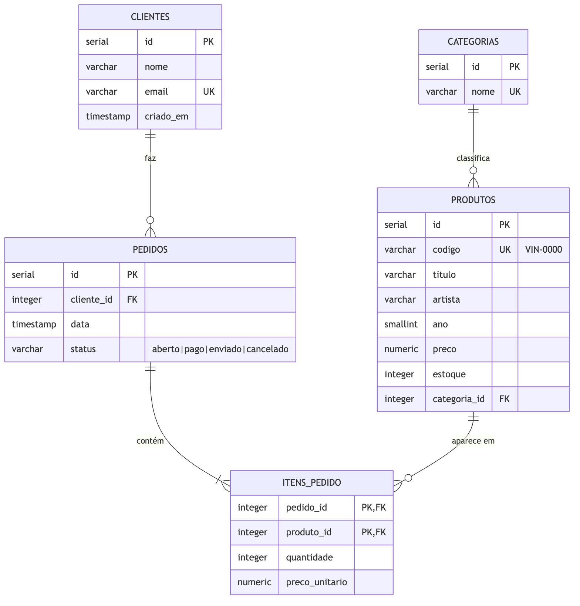

# 💿 Loja de Discos de Vinil: PostgreSQL + MongoDB

Atividade Final de **Banco de Dados II**, ADS SENAC Pelotas, 3º semestre. Entrega e apresentação na **Aula 18, 02/12/2026**.

Aplicação de terminal (CLI) de uma loja de discos de vinil que usa **dois bancos ao mesmo tempo**: o **PostgreSQL** guarda o catálogo, o estoque, os clientes e os pedidos; o **MongoDB** guarda as avaliações dos discos. A integração junta os dois numa ficha completa do disco: preço e estoque vêm do SQL, nota média e opiniões vêm do Mongo.

> Enunciado oficial: <https://github.com/gladimircc/bd2>

---

## 1. 👥 Integrantes

| Nome | GitHub |
|---|---|
| João Vicente Watanabe | [@joaowatanabe](https://github.com/joaowatanabe) |

> TODO: incluir os demais integrantes, se houver (grupo de até 4).

## 2–4. 📋 Tema, linguagem e SGBD

| Item | Escolha |
|---|---|
| **Tema** | Loja de discos de vinil (catálogo, pedidos e avaliações) |
| **Linguagem** | JavaScript (Node.js 20+, ES Modules) |
| **SGBD relacional** | PostgreSQL 17 |
| **Banco não relacional** | MongoDB 8 |
| **Drivers** | [`pg`](https://node-postgres.com/) e [`mongodb`](https://www.mongodb.com/docs/drivers/node/), oficiais, **sem ORM** (SQL puro parametrizado) |
| **Interface** | Menu no terminal (`node:readline`) |

---

## 5. ▶️ Como executar

Pré-requisitos: Node.js **20+** e Docker (no Mac: [Colima](https://github.com/abiosoft/colima)).

```bash
npm install
cp .env.example .env     # já vem apontando para as portas do docker compose (5433 / 27018)

colima start             # só no Mac com Colima
npm run db:up            # sobe PostgreSQL + MongoDB e espera ficarem prontos
                         # na 1ª subida, sql/*.sql e mongo/01_init.js rodam sozinhos
npm start                # abre o menu
```

| Script | O que faz |
|---|---|
| `npm run db:up` | `docker compose up -d --wait` |
| `npm run db:reset` | reaplica `sql/01_schema.sql`, `sql/02_seed.sql` e `mongo/01_init.js` (volta os dados ao estado inicial) |
| `npm run db:down` | derruba os containers (depois `colima stop` para liberar memória) |

**Sem Docker** (bancos instalados na máquina): ajuste o `.env` para `PG_PORT=5432` e `MONGO_URI=mongodb://localhost:27017`, depois
`createdb loja_vinil && psql -d loja_vinil -f sql/01_schema.sql -f sql/02_seed.sql` e `mongosh "mongodb://localhost:27017/loja_vinil" mongo/01_init.js`.

### O menu

```text
-- Conexões --          1. Testar conexões (PostgreSQL + MongoDB)
-- PostgreSQL --        2. Listar discos (JOIN)  3. Cadastrar  4. Alterar preço/estoque  5. Excluir
                        6. Pedidos com cliente e total (JOIN 4 tabelas)
-- MongoDB --           7. Listar avaliações  8. Buscar por título (regex)  9. Cadastrar
                       10. Alterar  11. Excluir  12. Índices e explain (IXSCAN × COLLSCAN)
-- Integração --       13. Ficha completa do disco  14. Catálogo ranqueado por nota
-- Demonstrações --    15. Inserir avaliação INVÁLIDA ($jsonSchema)  16. Testar a regex do código
```

Saídas reais de todas as opções: [`docs/evidencias.md`](docs/evidencias.md).

---

## 🗂️ Estrutura

```text
bd2-loja-vinil/
├── sql/01_schema.sql          # CREATE TABLE: 5 tabelas, PK, FK, CHECK, UNIQUE
├── sql/02_seed.sql            # dados de exemplo
├── mongo/01_init.js           # coleção avaliacoes + $jsonSchema + índice + seed
├── docker-compose.yml         # Postgres 17 (5433) + Mongo 8 (27018) com healthcheck
├── docs/
│   ├── modelo-er.md / .png    # modelo ER (Mermaid + imagem exportada)
│   ├── evidencias.md          # saídas reais dos testes
│   ├── aulas/01..09-*.md      # material de estudo, etapa por etapa
│   ├── ROTEIRO-APRESENTACAO.md
│   ├── PERGUNTAS-DO-PROFESSOR.md
│   └── TREINO-AO-VIVO.md
└── src/
    ├── index.js                       # menu: cada opção é uma função curta
    ├── cli/menu.js                    # perguntar() / perguntarNumero()
    ├── cli/erros.js                   # erros do PG e do $jsonSchema em texto legível + REGEX_CODIGO
    ├── db/postgres.js, db/mongo.js    # conexões
    ├── repositories/produtosRepository.js    # CRUD + JOIN (SQL)
    ├── repositories/pedidosRepository.js     # JOIN de 4 tabelas (SQL)
    ├── repositories/avaliacoesRepository.js  # CRUD + aggregate + explain (Mongo)
    └── services/integracaoService.js         # funcionalidades que usam os DOIS bancos
```

Camadas: `db/` só conecta, cada `repositories/` conversa com **um** banco, e `services/` junta os dois.

---

## 6. 🔌 Como os dois bancos são usados

### PostgreSQL (Parte 1)

Modelo ER: [`docs/modelo-er.md`](docs/modelo-er.md) · 

| Tabela | Papel | Chaves |
|---|---|---|
| `categorias` | gênero musical | PK `id`, `nome` UNIQUE |
| `produtos` | disco: código, preço, estoque | PK `id`, FK `categoria_id → categorias` |
| `clientes` | quem compra | PK `id`, `email` UNIQUE |
| `pedidos` | compra de um cliente | PK `id`, FK `cliente_id → clientes` |
| `itens_pedido` | discos de cada pedido (N:N) | PK composta, FKs para `pedidos` e `produtos` |

- **CRUD** de discos: menu 2–5 (`INSERT … RETURNING`, `SELECT`, `UPDATE`, `DELETE`, sempre com `$1, $2…`).
- **JOIN**: discos + categoria (menu 2) e pedidos + clientes + itens + produtos com `SUM`/`GROUP BY` (menu 6).
- **Integridade no banco**: `ON DELETE RESTRICT` impede excluir disco vendido; `CHECK` impede preço/estoque negativos; erros viram mensagens legíveis.

### MongoDB (Parte 2) — coleção `avaliacoes`

| Requisito | No `$jsonSchema` ([`mongo/01_init.js`](mongo/01_init.js)) |
|---|---|
| `required` | `produto_id, codigo_produto, cliente_email, nota, titulo, criado_em` |
| `bsonType` | `int`, `string`, `array`, `date` |
| `minimum`/`maximum` | `nota` entre 1 e 5 |
| `minLength`/`maxLength` | `titulo` 3–80, `comentario` até 1000 |
| `enum` | `sentimento` ∈ {positivo, neutro, negativo}; `estado_midia` ∈ {novo, seminovo, usado} |
| `pattern` | `codigo_produto`: `^VIN-[0-9]{4}$` · `cliente_email`: `^[\w.+-]+@[\w-]+(\.[\w-]+)+$` |
| Índice | `idx_avaliacoes_produto_id` em `{ produto_id: 1 }` |

- **CRUD**: menu 7–11 (`find`, `find` com `$regex`, `insertOne`, `updateOne` com `$set`, `deleteOne`).
- **Documento inválido**: menu 15 envia um documento com 5 violações; o Mongo recusa (erro 121) e o app lista cada regra quebrada.
- **Regex `^VIN-[0-9]{4}$`**: `^` início, `VIN-` literal, `[0-9]{4}` exatamente 4 dígitos, `$` fim. Aceita `VIN-0001`; recusa `vin-0001`, `VIN-12345`, `DISCO-1`.
- **Por que o índice em `produto_id`?** Toda integração começa com "avaliações do disco X" (`find({ produto_id })` / `$match: { produto_id }`). Sem índice o Mongo lê a coleção inteira (**COLLSCAN**); com índice vai direto aos documentos daquele disco (**IXSCAN**). O menu 12 mostra isso com `explain("executionStats")`: 3 documentos examinados com índice × 12 sem.

### Integração (Parte 3)

Ponte: **`produtos.id` (PostgreSQL) = `avaliacoes.produto_id` (MongoDB)**, juntados na aplicação ([`integracaoService.js`](src/services/integracaoService.js)).

- **Menu 13 · Ficha do disco**: `JOIN` no SQL (título, categoria, preço, estoque) + `$match`/`$group` no Mongo (nota média, total) + últimas opiniões.
- **Menu 14 · Catálogo ranqueado**: todos os discos do SQL ordenados pela média calculada no Mongo (2 consultas + `Map` na aplicação).
- **Menu 9 · Cadastrar avaliação**: antes de gravar no Mongo, confere no Postgres se o disco existe (o Mongo não tem FK) e copia o `codigo_produto`.

## 7. 🤔 Por que cada dado está em cada banco?

| Dado | Banco | Motivo |
|---|---|---|
| Discos, preço, estoque | **PostgreSQL** | Estrutura fixa. Preço e estoque precisam de consistência (`CHECK`, transação): vender um disco baixa o estoque e isso não pode ficar pela metade. `NUMERIC` exato para dinheiro. |
| Clientes e pedidos | **PostgreSQL** | Relações fortes (cliente → pedido → itens → disco) garantidas por FK. É dado financeiro: precisa de ACID e de `JOIN` para relatórios. |
| Avaliações | **MongoDB** | Conteúdo do usuário: texto livre e campos opcionais que variam (comentário, tags, estado da mídia). Cada avaliação é um documento autocontido, lido inteiro; o volume cresce rápido e o formato pode evoluir sem `ALTER TABLE`. O `$jsonSchema` garante o mínimo de qualidade. A avaliação **referencia** o disco por `produto_id` (Aula 12) porque a lista cresce sem limite. |

Resumo: o que é **transacional e relacionado** foi para o SQL; o que é **flexível e de conteúdo do usuário** foi para o Mongo.

---

## ✅ Checklist da entrega

- [x] A aplicação conecta ao PostgreSQL. (menu 1)
- [x] A aplicação conecta ao MongoDB. (menu 1)
- [x] O banco relacional tem pelo menos 3 tabelas relacionadas (são 5).
- [x] Inclusão, consulta, alteração e exclusão — SQL (menu 2–5) e Mongo (menu 7–11).
- [x] Pelo menos uma consulta com `JOIN` (menu 2 e 6).
- [x] O MongoDB tem validação com `$jsonSchema`.
- [x] Validação com expressão regular (`pattern`).
- [x] Pelo menos um índice no MongoDB (menu 12).
- [x] Funcionalidade que usa dados dos dois bancos (menu 13 e 14).
- [x] Modelo ER incluído (`docs/modelo-er.png`).
- [x] Scripts SQL e MongoDB incluídos.
- [x] O README explica como executar o projeto.
- [ ] Todos os integrantes conseguem explicar e demonstrar a aplicação → estudar `docs/aulas/` e `docs/TREINO-AO-VIVO.md`.

Roteiro da apresentação: [`docs/ROTEIRO-APRESENTACAO.md`](docs/ROTEIRO-APRESENTACAO.md).

## 🤖 Uso de IA

Usamos ferramentas de IA como apoio, como o enunciado permite. Todo o código foi revisado, e os integrantes sabem explicar e alterar as consultas, o schema e a integração.
