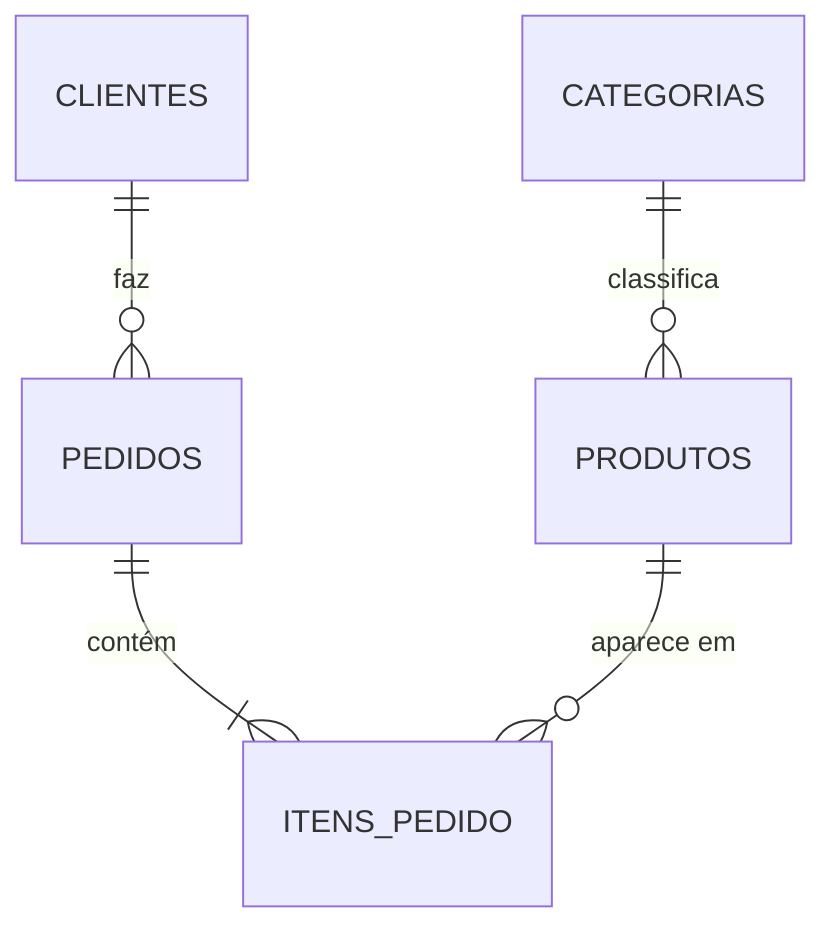

# Etapa 01 — Visão geral e modelagem

> **Objetivo da etapa:** entender O QUE o projeto faz, POR QUE ele usa dois bancos e como os dados foram divididos. Nada de código ainda: é a etapa que responde a pergunta nº 7 do README ("por que esse dado está nesse banco?").

## 1. O que é o projeto, em uma frase

Uma **loja de discos de vinil** que roda no terminal. O **PostgreSQL** guarda catálogo, estoque, clientes e pedidos; o **MongoDB** guarda as **avaliações** que os clientes escrevem sobre os discos. A funcionalidade de integração junta os dois: "ficha do disco" = preço e estoque (SQL) + nota média e opiniões (Mongo).

É exatamente o desenho que o professor colocou no enunciado:

```text
PostgreSQL: produto, preço, estoque
        +
MongoDB:    avaliações do produto
        ↓
Aplicação:  produto + preço + avaliação média
```

## 2. Por que dois bancos? (relacional × documento)

Pensa assim: **cada banco é bom num tipo de dado**.

| Pergunta | Se a resposta for "sim"… | Banco |
|---|---|---|
| O dado tem sempre os mesmos campos? | tabela com colunas fixas | PostgreSQL |
| Errar o valor dá prejuízo (preço, estoque, pedido)? | precisa de `CHECK`, `FK`, transação (ACID) | PostgreSQL |
| Preciso cruzar várias entidades (cliente → pedido → itens → disco)? | `JOIN` | PostgreSQL |
| O dado é texto livre, com campos que variam de um registro para outro? | documento flexível | MongoDB |
| Cada registro é "autocontido" e lido inteiro de uma vez? | um documento por avaliação | MongoDB |
| O volume cresce muito e o formato pode mudar com o tempo? | sem `ALTER TABLE` | MongoDB |

Resultado:

- **PostgreSQL** → `categorias`, `produtos`, `clientes`, `pedidos`, `itens_pedido`. Tudo "dinheiro e relacionamento".
- **MongoDB** → coleção `avaliacoes`. Uma avaliação pode ter só nota e título, ou ter comentário longo, tags, estado da mídia… Cada documento tem o formato que precisar, e o `$jsonSchema` (etapa 06) garante o mínimo de qualidade.

> **Frase pronta para a apresentação:** "O que é transacional e relacionado ficou no PostgreSQL; o que é conteúdo do usuário, flexível e que cresce rápido ficou no MongoDB."

## 3. Ligação com a Aula 12 (modelagem no MongoDB)

Na Aula 12 vimos **embutir × referenciar**:

- **Embutir**: os dados ficam dentro do mesmo documento (ex.: `pedidos` com array `itens`). Bom quando é lido junto e é limitado.
- **Referenciar**: documentos separados ligados por um id (ex.: `itens_pedido` com `pedido_id`). Bom quando a lista **cresce sem limite** ou é **atualizada separadamente**.

No nosso projeto, a avaliação **referencia** o disco pelo `produto_id` (o `id` da tabela `produtos` no Postgres), em vez de o disco ter um array gigante de avaliações dentro dele. Motivos (os mesmos da aula):

1. Um disco pode ter avaliações ilimitadas (lembra o limite de 16 MB por documento).
2. Cada avaliação é criada, editada e excluída sozinha.
3. O disco nem mora no Mongo: mora no Postgres. Então a referência é **entre bancos**.

E a **pegadinha da Aula 12** vale aqui: o MongoDB **não tem FOREIGN KEY**. Nada impede gravar `produto_id: 999`. Quem garante que o disco existe é **a aplicação** (vamos fazer isso na etapa 08: antes de gravar uma avaliação, o código pergunta ao Postgres se o disco existe).

## 4. O modelo ER (banco relacional)

O desenho completo está em [`docs/modelo-er.md`](../modelo-er.md) (Mermaid) e exportado como imagem em [`docs/modelo-er.png`](../modelo-er.png).



Como ler os símbolos (pé de galinha):

| Símbolo | Significa |
|---|---|
| `\|\|` | exatamente um |
| `o{` | zero ou muitos |
| `\|{` | um ou muitos |

- Uma **categoria** classifica zero ou muitos **produtos**; cada produto tem exatamente uma categoria (FK `produtos.categoria_id`).
- Um **cliente** faz zero ou muitos **pedidos** (FK `pedidos.cliente_id`).
- Um **pedido** contém um ou muitos **itens**, e cada item aponta para um **produto**.
- `itens_pedido` é a **tabela associativa** do N:N entre pedidos e produtos. A PK dela é **composta**: `(pedido_id, produto_id)` — o mesmo disco não aparece duas vezes no mesmo pedido; se comprar 2, a `quantidade` é 2.

Por que `itens_pedido` guarda `preco_unitario` se o produto já tem `preco`? Porque o preço do disco **muda** com o tempo; o pedido precisa lembrar quanto custou **no dia da compra**. (Pergunta clássica de professor.)

### A ponte com o Mongo

```text
produtos.id (PostgreSQL)  ═══  avaliacoes.produto_id (MongoDB)
produtos.codigo           ═══  avaliacoes.codigo_produto   (ex.: "VIN-0001")
```

## 5. Mapa do código (onde cada coisa vai morar)

```text
sql/01_schema.sql              → CREATE TABLE (etapa 03)
mongo/01_init.js               → coleção + $jsonSchema + índice (etapas 06 e 07)
src/db/                        → só conecta (etapa 02)
src/repositories/              → cada arquivo conversa com UM banco (etapas 03–07)
src/services/integracaoService → junta os dois bancos (etapa 08)
src/index.js                   → o menu
```

A ideia de camadas: se o professor pedir "muda o JOIN", você sabe que é em `repositories/` do SQL. Se pedir "muda a regra do schema", é em `mongo/01_init.js`. Se pedir "mostra a nota junto com o preço", é no `services/`.

---

## Sua vez

**Exercício 1.** O professor pergunta: "e se a loja quisesse guardar o *histórico de preços* de cada disco? Em qual banco e como?"

<details>
<summary>Resposta</summary>

No **PostgreSQL**, numa tabela nova `historico_precos (id SERIAL PK, produto_id INT FK → produtos, preco NUMERIC(10,2), alterado_em TIMESTAMP DEFAULT NOW())`. É dado financeiro, estruturado e ligado ao produto: precisa de FK e de consistência. No ER, `PRODUTOS ||--o{ HISTORICO_PRECOS : "teve"`.
</details>

**Exercício 2.** "E se a gente quisesse guardar as *fotos e o estado detalhado da capa* de cada disco usado (vincos, manchas, assinatura…), cada disco com itens diferentes?"

<details>
<summary>Resposta</summary>

No **MongoDB**: são atributos que variam de disco para disco (um tem assinatura, outro não, outro tem 3 tipos de defeito). Num banco relacional viraria uma tabela cheia de colunas `NULL` ou um monte de tabelas auxiliares. No Mongo vira um documento com os campos que existirem, por exemplo `{ produto_id: 3, capa: { vincos: true, assinatura: "Miles Davis" }, fotos: ["..."] }`.
</details>

## Perguntas de checagem

1. **Por que preço e estoque não ficaram no MongoDB?**
   Porque são dados financeiros que precisam de consistência forte: `CHECK (estoque >= 0)`, FK e transação. Vender um disco baixa o estoque e grava o pedido "tudo ou nada" (ACID).

2. **O MongoDB garante que `produto_id` existe no Postgres?**
   Não. MongoDB não tem chave estrangeira (pegadinha da Aula 12), e muito menos entre bancos diferentes. Quem garante é a aplicação.

3. **Por que a avaliação referencia o disco, em vez de ficar embutida num documento do disco?**
   Porque as avaliações crescem sem limite, são editadas uma a uma e o disco mora em outro banco. Pela regra da Aula 12, isso pede **referência**, não embutir.
