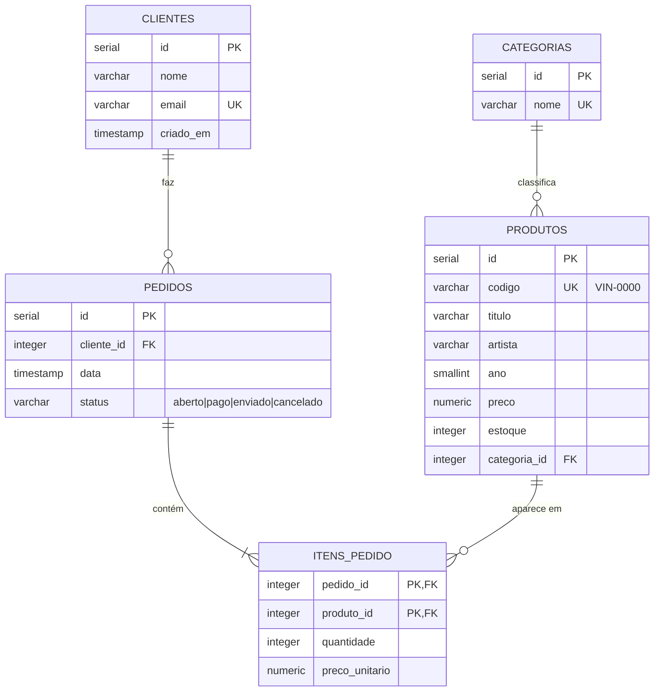
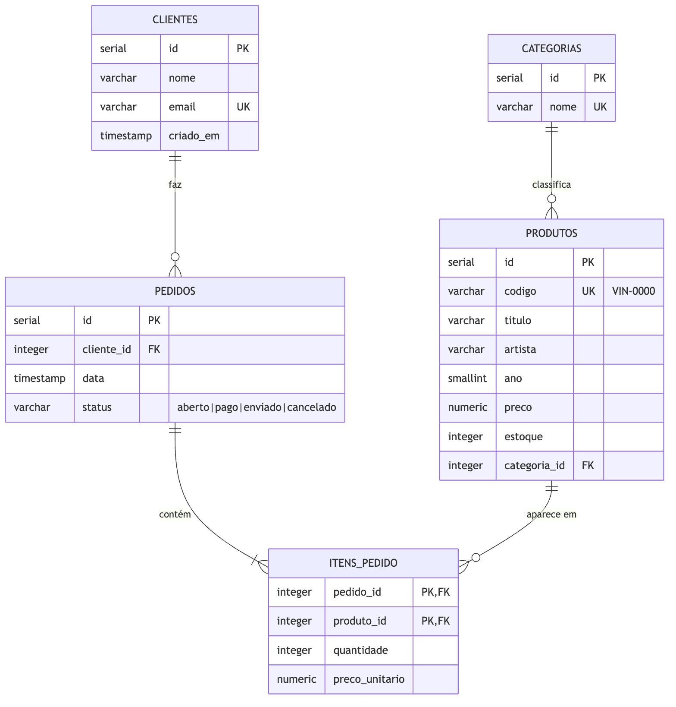

# Modelo ER — banco relacional (PostgreSQL)

## Ponte com o MongoDB

A coleção `avaliacoes` não tem FK (MongoDB não tem integridade referencial). Ela guarda `produto_id`, que é o `produtos.id` do PostgreSQL, e `codigo_produto`, igual a `produtos.codigo`. A aplicação faz a junção dos dois lados.

> Imagem gerada a partir do Mermaid acima com `@mermaid-js/mermaid-cli` (`mmdc -i er.mmd -o docs/modelo-er.png`).
